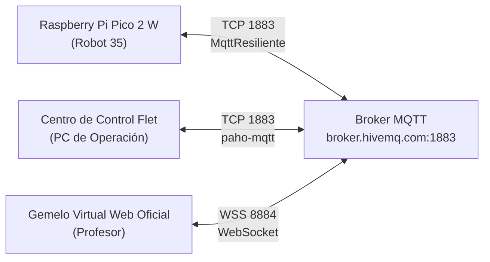
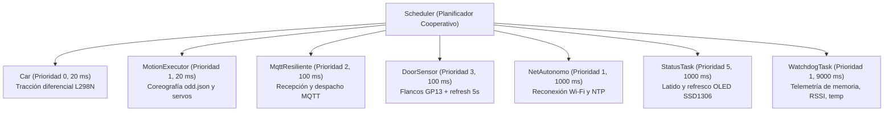

# Proyecto IoT Robot CAR — Robot 35
**Asignatura:** Internet de las Cosas (IoT) y Robótica Distribuida  
**Plataforma Embebida:** Raspberry Pi Pico 2 W (RP2350, MicroPython v1.28.0)  
**Centro de Control:** Python 3.13 + Flet 0.86.x + paho-mqtt 2.x  
**Identificación Oficial:** Robot 35 (Martes, Grupo 5) — Secuencia Impar (`odd.json`)  
**Broker MQTT:** `broker.hivemq.com:1883` (TCP nativo en Pico y Flet)  
**Prefijos Oficiales:** Primario `UDFJC/carrrobot/robot35/`, Alterno `UDFJC/iot_ws/robot35/`

---

## 1. Alcance y Evaluación Oficial (Cumplimiento de los 6 Puntos)

| # | Requisito Oficial Evaluado | Implementación Técnica | Estado Real en Hardware |
|---|---|---|---|
| **1** | **Línea Recta** | Cinemática diferencial inversa `v_l = v, v_r = v`, L298N (1 kHz PWM). | ✅ Confirmado en el aire / ⏳ Calibración piso pendiente |
| **2** | **1/4 de Círculo** | Cálculo de arco $v = \frac{\pi R}{2T}$, $w = \frac{\pi}{2T}$ con radio y duración configurables. | ✅ Cinemática validada en Flet y Pico |
| **3** | **Brazo Robótico** | Servos 100 Hz GP15 (hombro) y GP14 (codo). $s_1 = \alpha_1$, codo relativo $\theta_2 = \alpha_2 - \alpha_1$. Interpolación lineal continua. | ✅ Saturación [1000, 2000] us / ⏳ Calibración fina pendiente |
| **4** | **Coreografía Completa** | Reproducción paso a paso de `odd.json` agendada por hora UTC o disparo inmediato `run_at: "now"`. | ✅ Confirmado en hardware (completada en ~16 s) |
| **5** | **Watchdog y OLED** | Tarea `WatchdogTask` a 9s + `StatusTask` a 1s + `pot_scroll.py` (ADC GP26) para scroll de telemetría. | ✅ OLED y Watchdog confirmados / ⏳ Potenciómetro sin conectar |
| **6** | **Integración Gemelo Web** | Suscripción dual (`carrrobot` e `iot_ws`), LWT retenido en `status/online`, reporte de latido `status/heartbeat`. | ✅ Confirmado (recibido por el gemelo web oficial) |

---

## 2. Arquitectura del Sistema

### Diagrama General de Comunicaciones

### Arquitectura de Tareas Cooperativas del Firmware PicoROS (`pico_flash/`)

---

## 3. Conexiones y Asignación de Pines

| Componente | Pin Pico 2 W | Función / Señal | Advertencias Eléctricas |
|---|---|---|---|
| **Motor L298N IN1** | GP19 | Rueda Izquierda Avance | Alimentación lógica 3.3V desde Pico. Batería externa (6-12V) a bornera L298N. |
| **Motor L298N IN2** | GP18 | Rueda Izquierda Retroceso | |
| **Motor L298N IN3** | GP17 | Rueda Derecha Avance | Corregido manualmente en físico (`PIN_MOTOR_IN3 = 17, PIN_MOTOR_IN4 = 16`). |
| **Motor L298N IN4** | GP16 | Rueda Derecha Retroceso | |
| **Servo 1 (Hombro)** | GP15 | PWM 100 Hz | **OBLIGATORIO: 5V externos**, masa común (GND) con la Pico. |
| **Servo 2 (Codo)** | GP14 | PWM 100 Hz | **OBLIGATORIO: 5V externos**, masa común (GND) con la Pico. |
| **OLED SDA** | GP20 | I2C0 SDA (400 kHz) | Alimentación 3.3V (Pin 36), GND (Pin 38). |
| **OLED SCL** | GP21 | I2C0 SCL (400 kHz) | |
| **Sensor de Puerta** | GP13 | Entrada digital Pull-Up | Contacto seco magnético a GND (`AlarmModule` integrado). |
| **Receptor IR** | GP22 | Entrada PIO NEC 38 kHz | Alimentación 3.3V, salida de datos a GP22 (clave `1-2-4-7`). |
| **Potenciómetro (Opc.)** | GP26 | ADC0 (Pin 31) | Extremos a 3V3 (Pin 36) y GND, cursor central a GP26 (`POT_ENABLED=False`). |
| **Batería ADC (Opc.)** | GP28 | ADC2 (Pin 34) | Divisor resistivo externo cuando `BATTERY_ENABLED=True` (`battery/status`). |

---

## 4. Contrato MQTT Oficial

- **Prefijo Primario de Publicación:** `UDFJC/carrrobot/robot35/`
- **Prefijos de Suscripción Dual:** `UDFJC/carrrobot/robot35/` y `UDFJC/iot_ws/robot35/`
- **Filtro de Deduplicación:** Si llega el mismo comando por ambos prefijos en $<200$ ms, se ejecuta exactamente una vez.

| Tópico (sin prefijo) | Dirección | Formato Payload | Descripción |
|---|---|---|---|
| `motion/state` | Entrada | `{"v_dm/s": 2.0, "w_deg/s": 0.0, "alpha1_deg": 0.0, "alpha2_deg": 0.0, "duration_s": 2.0}` | Comando individual de tracción y brazo. |
| `motion/sequence` | Entrada | `{"action": "create", "name": "odd", "run_at": "now", "states": [...]}` | Registro y agendamiento de coreografía. |
| `robot/cmd` | Entrada | `{"cmd": "stop"}` \| `{"cmd": "lock"}` \| `{"cmd": "unlock"}` | Parada ejecutiva o bloqueo anti-sabotaje de pruebas. |
| `status/online` | Salida (Retenido) | `{"online": true, "robot_id": 35, "node": "emb_node_35", "ip": "..."}` | LWT retenido de presencia. |
| `status/heartbeat` | Salida (1 Hz) | `{"robot_id": 35, "uptime_s": 120, "wifi_ok": true, "mqtt_ok": true, ...}` | Telemetría vital viva. |
| `motion/status` | Salida | `{"status": "running", "sequence": "odd", "step": 1, "start_delay_ms": 12}` | Progreso y retraso de inicio de coreografía. |
| `CAR/status` | Salida | `{"status": "moviendo", "v": 0.2, "w": 0.0, "hardware_confirmed": true}` | Estado de tracción (máx. 1 cada 200 ms). |
