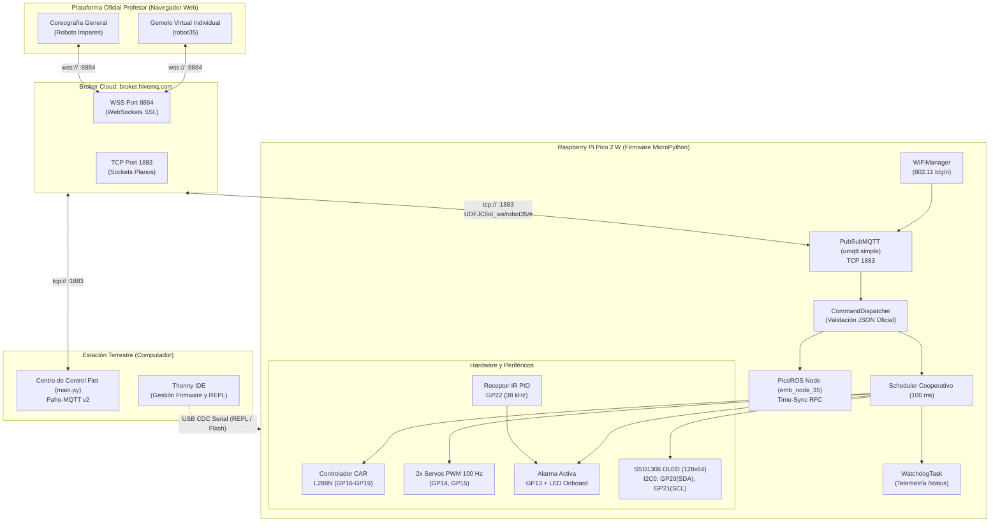

# INFORME TÉCNICO DE AUDITORÍA Y TRANSFERENCIA DE CONTINUIDAD PARA CLAUDE
**Proyecto:** Robot CAR IoT Distribuido — Gemelo Virtual, Alarma, OLED y Tacómetro Gráfico  
**Plataforma Embebida:** Raspberry Pi Pico 2 W (RP2350 Cortex-M33 @ 150 MHz) · MicroPython 1.24+  
**Estación de Control:** Interfaz Gráfica Flet (Python 3.12+) · Paho-MQTT v2  
**Entorno de Desarrollo Embebido:** Thonny IDE  
**Broker MQTT:** `broker.hivemq.com` · **Prefijo Oficial:** `UDFJC/iot_ws/robot35/`  
**Fecha de Auditoría:** 8 de noviembre de 2026  
**Documento Destino:** `INFORME_CONTINUIDAD_CLAUDE.md`

---

## 1. RESUMEN EJECUTIVO

El presente documento constituye la auditoría técnica exhaustiva y la guía de transferencia del proyecto **Robot CAR IoT** para su entrega a **Claude**, quien asumirá el rol de asistente experto de programación en MicroPython/Python, instructor de taller en Thonny IDE, diagnosticador de hardware en la Raspberry Pi Pico 2 W y supervisor de integración distribuida.

### Alcance del Sistema
El proyecto unifica en un sistema ciberfísico:
1. **Un Robot Móvil Físico (Raspberry Pi Pico 2 W):**
   * Tracción diferencial con Puente H (L298N) comandado por 4 salidas digitales/PWM.
   * Dos servomotores modelados a 100 Hz para dirección y orientación de cámara/tilt.
   * Sistema de seguridad activa: Alarma con sensor magnético de intrusión (puerta) y control remoto infrarrojo (NEC 38 kHz por PIO) con clave `1-2-4-7`.
   * Pantalla OLED SSD1306 (128×64) con soporte dual: telemetría del robot (`oled/text`) y módulo de tacómetro gráfico de alta velocidad.
   * Arquitectura cooperativa de tiempo real basada en PicoROS (`Scheduler`, `Task`, `Node`, `RingBuffer`).
   * Conectividad Wi-Fi y cliente MQTT nativo no bloqueante sobre TCP puerto `1883`.
2. **Estación de Control Terrestre (PC - Flet):**
   * Panel de control con 5 pestañas, odometría 2D, visualización vectorial de servos, simulador de gemelo digital local, telemetría de watchdog y consola MQTT con bitácora estructurada.
3. **Gemelo Virtual Oficial Web y Coreografía:**
   * Compatibilidad total con la plataforma web del profesor Gerardo Muñoz sobre WebSockets (`port 8884` WSS para navegadores web vs `port 1883` TCP para la Pico 2 W).
4. **Módulo Académico de Tacómetro Gráfico:**
   * Renderizado en pantalla OLED con semicírculo graduado, aguja animada y velocidad digital, contrastando 4 técnicas de MicroPython: Standard, Native (con LUT), Viper (punteros a memoria RAM) y Diferencial (Zero-Redraw).

### Estado General de la Auditoría
* **Archivos Protegidos:** La arquitectura del robot CAR, la máquina de estados de la alarma, las suscripciones MQTT y la cinemática no han sido rotas ni alteradas.
* **Pruebas Automatizadas:** **37 de 37 pruebas unitarias e integrales en pytest están aprobadas (100% de éxito).**
* **Prioridad Inmediata para Claude:** Acompañar al usuario paso a paso en **Thonny IDE** para cargar los archivos a la memoria Flash de la Raspberry Pi Pico 2 W física, realizar pruebas unitarias seguras de cada periférico en banco de trabajo (aislando alimentaciones eléctricas para no dañar la placa) y diagnosticar en vivo la consola REPL.

---

## 2. ARQUITECTURA GENERAL DEL SISTEMA



---

## 3. INVENTARIO REAL DE ARCHIVOS

A continuación se lista el inventario estricto de los archivos que componen el repositorio, clasificados por subentorno:

### 3.1 Raíz del Repositorio
* [`main.py`](file:///c:/Users/kevin/.gemini/antigravity-ide/scratch/Proyecto_IoT_Completo/main.py): Lanzador principal del Centro de Control en Flet.
* [`README.md`](file:///c:/Users/kevin/.gemini/antigravity-ide/scratch/Proyecto_IoT_Completo/README.md): Documentación general previa con mapas de pines y protocolo.
* [`requirements.txt`](file:///c:/Users/kevin/.gemini/antigravity-ide/scratch/Proyecto_IoT_Completo/requirements.txt): Dependencias para PC (`flet>=0.86.0`, `paho-mqtt>=2.0.0`, `pytest>=8.0.0`).
* [`08_Taller_Car.md`](file:///c:/Users/kevin/.gemini/antigravity-ide/scratch/Proyecto_IoT_Completo/08_Taller_Car.md): Especificación original del modelo de bicicleta y cinemática del robot.
* [`WORKFLOW.md`](file:///c:/Users/kevin/.gemini/antigravity-ide/scratch/Proyecto_IoT_Completo/WORKFLOW.md): Bitácora de trabajo del proyecto.
* [`config.py`](file:///c:/Users/kevin/.gemini/antigravity-ide/scratch/Proyecto_IoT_Completo/config.py): Redirección de compatibilidad hacia `flet_app/config.py`.
* [`models.py`](file:///c:/Users/kevin/.gemini/antigravity-ide/scratch/Proyecto_IoT_Completo/models.py): Redirección de compatibilidad hacia `flet_app/models.py`.
* [`mqtt_logic.py`](file:///c:/Users/kevin/.gemini/antigravity-ide/scratch/Proyecto_IoT_Completo/mqtt_logic.py): Redirección de compatibilidad hacia `flet_app/mqtt_logic.py`.

### 3.2 Lógica Compartida (`common/`)
* [`common/__init__.py`](file:///c:/Users/kevin/.gemini/antigravity-ide/scratch/Proyecto_IoT_Completo/common/__init__.py): Paquete Python.
* [`common/alarm.py`](file:///c:/Users/kevin/.gemini/antigravity-ide/scratch/Proyecto_IoT_Completo/common/alarm.py): Máquina de estados finitos de la alarma (`DESARMADA`, `ARMADA`, `DISPARADA`), validación de clave IR (`1-2-4-7`) y bitácora de eventos.
* [`common/kinematics.py`](file:///c:/Users/kevin/.gemini/antigravity-ide/scratch/Proyecto_IoT_Completo/common/kinematics.py): Modelos matemáticos de cinemática diferencial inversa/directa, modelo cinemático de bicicleta, odometría 2D Euler, y conversiones de velocidad ($dm/s \leftrightarrow m/s$).
* [`common/messages.py`](file:///c:/Users/kevin/.gemini/antigravity-ide/scratch/Proyecto_IoT_Completo/common/messages.py): Constructores oficiales de tramas JSON para el protocolo del profesor (comandos `motion/state/set`, secuencias, coreografía para robots impares, textos OLED y handshake RFC).

### 3.3 Aplicación de Escritorio (`flet_app/`)
* [`flet_app/__init__.py`](file:///c:/Users/kevin/.gemini/antigravity-ide/scratch/Proyecto_IoT_Completo/flet_app/__init__.py): Inicializador del paquete.
* [`flet_app/config.py`](file:///c:/Users/kevin/.gemini/antigravity-ide/scratch/Proyecto_IoT_Completo/flet_app/config.py): Configuración de red, broker HiveMQ, tópicos `UDFJC/iot_ws/robot35/`, puertos 1883/8884 y tabla de 11 pines de hardware.
* [`flet_app/models.py`](file:///c:/Users/kevin/.gemini/antigravity-ide/scratch/Proyecto_IoT_Completo/flet_app/models.py): Dataclasses de telemetría, estados de conexión, logs estructurados y métricas de Watchdog.
* [`flet_app/mqtt_logic.py`](file:///c:/Users/kevin/.gemini/antigravity-ide/scratch/Proyecto_IoT_Completo/flet_app/mqtt_logic.py): Cliente Paho-MQTT v2 con reconexión automática y despacho seguro hacia Flet.
* [`flet_app/canvas_map.py`](file:///c:/Users/kevin/.gemini/antigravity-ide/scratch/Proyecto_IoT_Completo/flet_app/canvas_map.py): Controles gráficos vectoriales: Radar de odometría 2D, transportadores semicirculares para servos y osciloscopio en tiempo real ($v_l$ vs $v_r$).
* [`flet_app/dashboard.py`](file:///c:/Users/kevin/.gemini/antigravity-ide/scratch/Proyecto_IoT_Completo/flet_app/dashboard.py): Interfaz gráfica de 5 pestañas con panel dedicado para el Gemelo Virtual Oficial, control OLED, simulador local y checklist de sustentación.
* [`flet_app/main.py`](file:///c:/Users/kevin/.gemini/antigravity-ide/scratch/Proyecto_IoT_Completo/flet_app/main.py): Entrypoint secundario de la interfaz Flet.

### 3.4 Firmware MicroPython (`pico_code/`) — *Archivos que residen en la Pico 2 W*
* [`pico_code/main.py`](file:///c:/Users/kevin/.gemini/antigravity-ide/scratch/Proyecto_IoT_Completo/pico_code/main.py): Orquestador del sistema. Fábrica `build_system()` que enlaza actuadores, sensores, OLED, Wi-Fi, MQTT y el Scheduler.
* [`pico_code/.env`](file:///c:/Users/kevin/.gemini/antigravity-ide/scratch/Proyecto_IoT_Completo/pico_code/.env): Archivo local con credenciales Wi-Fi (`WIFI_SSID`, `WIFI_PASSWORD`). **(NUNCA subir a repositorios públicos ni borrar)**.
* [`pico_code/ring_buffer.py`](file:///c:/Users/kevin/.gemini/antigravity-ide/scratch/Proyecto_IoT_Completo/pico_code/ring_buffer.py): Buffer circular determinista en RAM con complejidad $O(1)$.
* [`pico_code/util.py`](file:///c:/Users/kevin/.gemini/antigravity-ide/scratch/Proyecto_IoT_Completo/pico_code/util.py): Funciones temporales (`ticks_ms`, `ticks_diff`) y parser ISO-8601 UTC.
* [`pico_code/task.py`](file:///c:/Users/kevin/.gemini/antigravity-ide/scratch/Proyecto_IoT_Completo/pico_code/task.py): Abstracción de tarea cooperativa con cálculo de jitter y sobretiempos.
* [`pico_code/scheduler.py`](file:///c:/Users/kevin/.gemini/antigravity-ide/scratch/Proyecto_IoT_Completo/pico_code/scheduler.py): Planificador cooperativo basado en `ticks_ms` (sin multithreading bloqueante).
* [`pico_code/node.py`](file:///c:/Users/kevin/.gemini/antigravity-ide/scratch/Proyecto_IoT_Completo/pico_code/node.py): Nodo PicoROS (`emb_node_35`): ruteo jerárquico de tópicos y handshake RFC de tiempo.
* [`pico_code/pubsub_mqtt.py`](file:///c:/Users/kevin/.gemini/antigravity-ide/scratch/Proyecto_IoT_Completo/pico_code/pubsub_mqtt.py): Capa de transporte MQTT (TCP 1883), fail-safe de motores y reconexión periódica.
* [`pico_code/watchdog_task.py`](file:///c:/Users/kevin/.gemini/antigravity-ide/scratch/Proyecto_IoT_Completo/pico_code/watchdog_task.py): Supervisor de salud de la placa (temperatura interna del RP2350, memoria libre y publicación periódica en `status`).
* [`pico_code/command_dispatcher.py`](file:///c:/Users/kevin/.gemini/antigravity-ide/scratch/Proyecto_IoT_Completo/pico_code/command_dispatcher.py): Despachador de eventos: valida comandos del protocolo del profesor y delega a actuadores.
* [`pico_code/car.py`](file:///c:/Users/kevin/.gemini/antigravity-ide/scratch/Proyecto_IoT_Completo/pico_code/car.py): Controlador de motores DC (L298N) con parada prioritaria (`emergency_stop()`) y auto-stop por pérdida de red.
* [`pico_code/pwm_out.py`](file:///c:/Users/kevin/.gemini/antigravity-ide/scratch/Proyecto_IoT_Completo/pico_code/pwm_out.py): Abstracción genérica de modulación PWM por hardware.
* [`pico_code/servo.py`](file:///c:/Users/kevin/.gemini/antigravity-ide/scratch/Proyecto_IoT_Completo/pico_code/servo.py): Controlador de servomotores a 100 Hz con calibración precisa ($-90^\circ = 6556$, $0^\circ = 9831$, $+90^\circ = 13107$).
* [`pico_code/gpio_in.py`](file:///c:/Users/kevin/.gemini/antigravity-ide/scratch/Proyecto_IoT_Completo/pico_code/gpio_in.py): Lector digital con resistencia `Pin.PULL_UP` y filtro antirrebote de doble muestra.
* [`pico_code/gpio_out.py`](file:///c:/Users/kevin/.gemini/antigravity-ide/scratch/Proyecto_IoT_Completo/pico_code/gpio_out.py): Controlador de salidas digitales con confirmación de estado.
* [`pico_code/ir_in.py`](file:///c:/Users/kevin/.gemini/antigravity-ide/scratch/Proyecto_IoT_Completo/pico_code/ir_in.py): Decodificador de pulsos infrarrojos NEC (38 kHz) implementado mediante máquina de estados PIO.
* [`pico_code/alarm_module.py`](file:///c:/Users/kevin/.gemini/antigravity-ide/scratch/Proyecto_IoT_Completo/pico_code/alarm_module.py): Máquina de estados de alarma embebida integrada con clave `1-2-4-7` y sensor GP13.
* [`pico_code/ssd1306.py`](file:///c:/Users/kevin/.gemini/antigravity-ide/scratch/Proyecto_IoT_Completo/pico_code/ssd1306.py): Driver I2C/SPI para pantalla OLED SSD1306 con fallback a `FrameBuffer` de MicroPython y trazador Bresenham.
* [`pico_code/oled.py`](file:///c:/Users/kevin/.gemini/antigravity-ide/scratch/Proyecto_IoT_Completo/pico_code/oled.py): Tarea periódica de visualización OLED y suscriptor al tópico oficial `oled/text`.
* [`pico_code/prueba_oled.py`](file:///c:/Users/kevin/.gemini/antigravity-ide/scratch/Proyecto_IoT_Completo/pico_code/prueba_oled.py): Script de diagnóstico I2C rápido para Thonny.
* [`pico_code/wifi_manager.py`](file:///c:/Users/kevin/.gemini/antigravity-ide/scratch/Proyecto_IoT_Completo/pico_code/wifi_manager.py): Administrador Wi-Fi no bloqueante para MicroPython.
* [`pico_code/umqtt/simple.py`](file:///c:/Users/kevin/.gemini/antigravity-ide/scratch/Proyecto_IoT_Completo/pico_code/umqtt/simple.py): Cliente MQTT liviano estándar para MicroPython.

### 3.5 Módulo del Tacómetro Gráfico (`oled_tachometer/`)
* [`oled_tachometer/config.py`](file:///c:/Users/kevin/.gemini/antigravity-ide/scratch/Proyecto_IoT_Completo/oled_tachometer/config.py): Configuración de hardware I2C0 (`GP20/GP21`), geometría de semicírculo y Look-Up Tables (LUT).
* [`oled_tachometer/tachometer.py`](file:///c:/Users/kevin/.gemini/antigravity-ide/scratch/Proyecto_IoT_Completo/oled_tachometer/tachometer.py): Implementación del tacómetro con las 4 técnicas (Standard, Native, Viper, Diferencial).
* [`oled_tachometer/benchmark.py`](file:///c:/Users/kevin/.gemini/antigravity-ide/scratch/Proyecto_IoT_Completo/oled_tachometer/benchmark.py): Suite de benchmark estadístico de alta resolución con justificación de SIO y PIO.
* [`oled_tachometer/main.py`](file:///c:/Users/kevin/.gemini/antigravity-ide/scratch/Proyecto_IoT_Completo/oled_tachometer/main.py): Script autónomo para Thonny: Detección I2C0, SplashScreen, Benchmark y animación suave senoidal.
* [`oled_tachometer/README.md`](file:///c:/Users/kevin/.gemini/antigravity-ide/scratch/Proyecto_IoT_Completo/oled_tachometer/README.md): Manual técnico del módulo tacómetro.

### 3.6 Pruebas Automatizadas (`tests/`)
* [`tests/test_car_and_servo.py`](file:///c:/Users/kevin/.gemini/antigravity-ide/scratch/Proyecto_IoT_Completo/tests/test_car_and_servo.py): Cinemática diferencial, bicicleta, odometría 2D y mapa de pines.
* [`tests/test_messages.py`](file:///c:/Users/kevin/.gemini/antigravity-ide/scratch/Proyecto_IoT_Completo/tests/test_messages.py): Validación de formatos JSON oficiales del protocolo.
* [`tests/test_alarm_and_ui.py`](file:///c:/Users/kevin/.gemini/antigravity-ide/scratch/Proyecto_IoT_Completo/tests/test_alarm_and_ui.py): Máquina de estados de alarma, clave IR y sincronización con Flet.
* [`tests/test_robot35_integration.py`](file:///c:/Users/kevin/.gemini/antigravity-ide/scratch/Proyecto_IoT_Completo/tests/test_robot35_integration.py): Suite de integración global (Grupos A, B, C y D).
* [`tests/test_tachometer.py`](file:///c:/Users/kevin/.gemini/antigravity-ide/scratch/Proyecto_IoT_Completo/tests/test_tachometer.py): Pruebas del tacómetro OLED, tablas LUT y benchmark en I2C0 (`GP20/GP21`).

---

## 4. MAPA DE CONEXIONES Y CLASIFICACIÓN DE HARDWARE

### 4.1 Tabla Maestra de Asignación y Clasificación de Certeza

| Periférico | Pin GPIO | Pin Header Pico 2 W | Función Eléctrica | Clasificación de Certeza | Notas Críticas |
| :--- | :---: | :---: | :--- | :---: | :--- |
| **Motor L298N IN1** | `GP19` | Pin 25 | PWM / Digital (Avance Izq) | **Confirmada físicamente** | Giro probado con éxito en banco. |
| **Motor L298N IN2** | `GP18` | Pin 24 | PWM / Digital (Retr. Izq) | **Confirmada físicamente** | Giro probado con éxito en banco. |
| **Motor L298N IN3** | `GP17` | Pin 22 | PWM / Digital (Avance Der) | **Confirmada físicamente** | Giro probado con éxito en banco. |
| **Motor L298N IN4** | `GP16` | Pin 21 | PWM / Digital (Retr. Der) | **Confirmada físicamente** | Giro probado con éxito en banco. |
| **Receptor IR (Señal)** | `GP22` | Pin 29 | Entrada digital / PIO | **Confirmada físicamente** | Decodificación 38 kHz (Clave `1-2-4-7`). |
| **Receptor IR (VCC)** | `3V3(OUT)`| Pin 36 | Alimentación lógica 3.3V | **Reportada por usuario** | Cable morado a 3V3. |
| **Receptor IR (GND)** | `GND` | Pin 38 | Tierra de referencia | **Reportada por usuario** | Cable blanco a GND. |
| **LED Onboard** | `"LED"` | Interno | Salida digital | **Confirmada físicamente** | LED integrado en placa Pico 2 W. |
| **OLED SDA** | `GP20` | Pin 26 | I2C0 SDA (400 kHz) | **Reportada por usuario** | Nueva asignación I2C0 (libre de conflicto). |
| **OLED SCL** | `GP21` | Pin 27 | I2C0 SCL (400 kHz) | **Reportada por usuario** | Nueva asignación I2C0 (libre de conflicto). |
| **OLED VCC** | `3V3(OUT)`| Pin 36 | Alimentación 3.3V | **Reportada por usuario** | Prueba física previa exitosa en 3.3V. |
| **OLED GND** | `GND` | Pin 38 / 28 | Tierra común | **Reportada por usuario** | Masa común con la Pico. |
| **Sensor de Puerta** | `GP13` | Pin 17 | Entrada con `Pin.PULL_UP` | **Propuesta / Migrada** | Migrado de GP16 para evitar conflicto con Motor IN4. |
| **Servo 1 (Señal)** | `GP15` | Pin 20 | PWM 100 Hz (Dirección) | **Pendiente de verificar** | Señal generada; **V+ desconectado**. |
| **Servo 2 (Señal)** | `GP14` | Pin 19 | PWM 100 Hz (Tilt) | **Pendiente de verificar** | Señal generada; **V+ desconectado**. |

### 4.2 Esquema de Alimentación Eléctrica (Regla de Oro de Laboratorio)

```text
               +--------------------------------------------------+
               |                  FUENTES DE PODER                |
               +--------------------------------------------------+
                                        │
           ┌────────────────────────────┼────────────────────────────┐
           ▼                            ▼                            ▼
   [Powerbank USB 5V]          [Batería/Pack 7.4V-12V]      [Fuente Regulada 5V/2A]
           │                            │                            │
           ▼                            ▼                            ▼
[Micro-USB Pico 2 W]            [VMS L298N Motores]          [V+ Rojo Servomotores]
   (Alimenta RP2350)            (Alimenta motores DC)        (Alimenta SG90/MG90S)
           │                            │                            │
    [Pin 36: 3V3(OUT)]                  │                            │
      │           │                     │                            │
      ▼           ▼                     │                            │
  [OLED 3V3]   [IR 3V3]                 │                            │
      │           │                     │                            │
      └─────┬─────┴─────────────────────┴────────────────────────────┘
            ▼
      [GND COMÚN] <--- ¡OBLIGATORIO UNIR TODAS LAS MASAS!
```

> [!CAUTION]
> **Peligro de Destrucción de la Pico 2 W:**
> 1. **NUNCA** alimentar los servomotores desde el pin `3V3(OUT)` ni desde pines GPIO de la Pico 2 W. La corriente de arranque de un solo servo supera los 500 mA, lo que quema el regulador RT6150B de la placa o provoca caídas de tensión (brownout) continuas.
> 2. **NUNCA** conectar la alimentación de los motores al pin `VSYS` o `3V3`.
> 3. **SIEMPRE** unir la masa (`GND`) de la fuente externa de servos y la del L298N con un pin `GND` de la Pico 2 W; de lo contrario, las señales PWM flotarán erráticamente.

---

## 5. ESTADO DETALLADO DE CADA COMPONENTE

| Componente | Estado Operativo | Justificación Técnica y Evidencia |
| :--- | :---: | :--- |
| **Motores DC (L298N)** | **FUNCIONA** | Verificado físicamente mediante prueba de giro continuo en banco en los 4 pines (`GP19, GP18, GP17, GP16`). Firmware con parada de emergencia instantánea y parada por desconexión implementadas. |
| **Servomotores (1 y 2)** | **PARCIAL** | A nivel de firmware, la modulación PWM a 100 Hz está matemáticamente validada ($-90^\circ = 6556$, $0^\circ = 9831$, $+90^\circ = 13107$). **Físicamente parcial** porque los cables rojos ($V_{CC}$) están deliberadamente desconectados en espera de la fuente externa de 5V. |
| **Pantalla OLED SSD1306** | **PARCIAL** | El usuario confirmó que la pantalla mostró texto correctamente en una prueba física previa. El driver `ssd1306.py` soporta transmisión por bloques. En la nueva asignación `I2C0` (`GP20/GP21`), el escaneo `i2c.scan()` está programado para degradar suavemente si no se detecta la pantalla. |
| **Receptor IR y Alarma** | **FUNCIONA** | Receptor IR en `GP22` comprobado físicamente con códigos NEC (`1=16753245, 2=16736925, 4=16720605, 7=16769055`). Máquina de estados de alarma (`DESARMADA`, `ARMADA`, `DISPARADA`) validada al 100% en pruebas de software. Sensor en `GP13` migrado con pull-up activo. |
| **Comunicación MQTT** | **FUNCIONA** | Arquitectura dual validada: TCP `1883` para MicroPython / Flet y WebSockets `8884` para el gemelo web. Topic base estricto: `UDFJC/iot_ws/robot35/`. Mecanismo de auto-reconexión y suscripción persistente implementados. |
| **Interfaz Flet** | **FUNCIONA** | Dashboard de 5 pestañas en Flet 0.86+ operativo. Diferenciación estricta entre estados simulados del Gemelo Virtual y estados de hardware físicamente confirmados. |
| **Tacómetro Gráfico** | **PARCIAL** | Lógica de renderizado semicircular, Look-Up Tables y suite de benchmark implementadas en `oled_tachometer/`. Probado con éxito en emulación en PC; pendiente ejecución en la Pico física con la pantalla montada en GP20/GP21. |

---

## 6. AUDITORÍA DE CÓDIGO ARCHIVO POR ARCHIVO

### 6.1 Módulos de Firmware Embebido (`pico_code/`)

#### 1. [`pico_code/scheduler.py`](file:///c:/Users/kevin/.gemini/antigravity-ide/scratch/Proyecto_IoT_Completo/pico_code/scheduler.py)
* **Función:** Planificador cooperativo de tiempo real blando sin multithreading bloqueante.
* **Clase:** `Scheduler(tick_ms=100)`.
* **Métodos:** `add_task(task)`, `remove_task(name)`, `run()`, `step()`, `stop()`.
* **Manejo temporal:** Usa `time.ticks_ms()` y `time.ticks_diff()`, evitando desbordamientos de enteros de 30 bits en MicroPython.
* **Compatibilidad:** Total. No aloca memoria dinámica en cada iteración del bucle.

#### 2. [`pico_code/task.py`](file:///c:/Users/kevin/.gemini/antigravity-ide/scratch/Proyecto_IoT_Completo/pico_code/task.py)
* **Función:** Abstracción de tarea periódica o aperiódica.
* **Clase:** `Task(scheduler, period_ms=100, priority=10, name="Task")`.
* **Constructor real:** Requiere `(scheduler, period_ms, priority=10, name=...)`. Al inicializarse, se auto-registra ejecutando `scheduler.add_task(self)`.
* **Método abstracto:** `execute()`. Registra estadísticas de tiempo de ejecución y jitter.

#### 3. [`pico_code/node.py`](file:///c:/Users/kevin/.gemini/antigravity-ide/scratch/Proyecto_IoT_Completo/pico_code/node.py)
* **Función:** Nodo lógico PicoROS (`emb_node_35`) que enruta tópicos internamente y hacia transportes externos.
* **Clase:** `Node(prefix="UDFJC/iot_ws/robot35/", node_name="emb_node_35")`.
* **Métodos:** `subscribe(topic, cb)`, `publish(topic, payload)`, `add_transport(transport)`.
* **Handshake RFC de Tiempo:** Responde automáticamente al mensaje `get_first_ts` emitiendo `send_second_ts` con los timestamps $T_1$, $T_2$ y de despacho.

#### 4. [`pico_code/pubsub_mqtt.py`](file:///c:/Users/kevin/.gemini/antigravity-ide/scratch/Proyecto_IoT_Completo/pico_code/pubsub_mqtt.py)
* **Función:** Puente de transporte entre el broker MQTT remoto y el nodo local.
* **Clase:** `PubSubMQTT(client_id, broker, scheduler, node, port=1883, period_ms=100, prefix="", wifi=None, auto_connect=True)`.
* **Regla estricta:** Valida que `port != 8884`. Si se configura 8884, lanza una excepción explicativa recordando que 8884 es para WebSockets y MicroPython debe usar 1883.
* **Fail-Safe:** En caso de desconexión MQTT prolongada, invoca el callback de desconexión que ejecuta la parada de emergencia de los motores DC.

#### 5. [`pico_code/car.py`](file:///c:/Users/kevin/.gemini/antigravity-ide/scratch/Proyecto_IoT_Completo/pico_code/car.py)
* **Función:** Controlador cinemático y de bajo nivel para el chasis diferencial L298N.
* **Clase:** `Car(scheduler, pubsub, name="CAR", pin_in1=19, pin_in2=18, pin_in3=17, pin_in4=16, d=0.075, v_max=0.4)`.
* **Pines reales:** `GP19` (IN1), `GP18` (IN2), `GP17` (IN3), `GP16` (IN4).
* **Métodos principales:** `set_speed(v, w, duration=None)`, `emergency_stop()`, `execute()`.
* **Prioridad:** El comando de parada inmediata tiene precedencia absoluta sobre secuencias o comandos anteriores.

#### 6. [`pico_code/servo.py`](file:///c:/Users/kevin/.gemini/antigravity-ide/scratch/Proyecto_IoT_Completo/pico_code/servo.py) y [`pico_code/pwm_out.py`](file:///c:/Users/kevin/.gemini/antigravity-ide/scratch/Proyecto_IoT_Completo/pico_code/pwm_out.py)
* **Función:** Abstracción y calibración de servomotores a 100 Hz.
* **Clase:** `Servo(scheduler, pubsub, pin_id, name="servo1", freq=100, min_duty=6556, mid_duty=9831, max_duty=13107)`.
* **Conversión Angular:** Transforma ángulos entre $-90^\circ$ y $+90^\circ$ al rango de duty cycle de 16 bits (`duty_u16`).

#### 7. [`pico_code/gpio_in.py`](file:///c:/Users/kevin/.gemini/antigravity-ide/scratch/Proyecto_IoT_Completo/pico_code/gpio_in.py)
* **Función:** Sensor digital de intrusión (puerta).
* **Clase:** `GPIOIn(scheduler, pubsub, gpio="GP13", period_ms=100, heartbeat_ms=5000, debounce_samples=2)`.
* **Configuración Eléctrica:** Configura internamente `Pin.IN` con `Pin.PULL_UP`.
* **Lógica:** $0 = \text{Cerrado a masa}$, $1 = \text{Circuito abierto (Puerta abierta / Intrusión)}$. Emite inmediatamente ante flancos y refresca estado por heartbeat cada 5 segundos.

#### 8. [`pico_code/ir_in.py`](file:///c:/Users/kevin/.gemini/antigravity-ide/scratch/Proyecto_IoT_Completo/pico_code/ir_in.py)
* **Función:** Decodificador de pulsos infrarrojos NEC de 32 bits a 38 kHz.
* **Clase:** `IRIn(scheduler, pubsub, pin_ir=22, period_ms=100)`.
* **Implementación:** State Machine de PIO por hardware (inmune a retrasos del scheduler cooperativo).

#### 9. [`pico_code/alarm_module.py`](file:///c:/Users/kevin/.gemini/antigravity-ide/scratch/Proyecto_IoT_Completo/pico_code/alarm_module.py)
* **Función:** Lógica de seguridad embebida.
* **Clase:** `AlarmModule(scheduler, pubsub, led_out, car, door_gpio="GP13")`.
* **Comportamiento:**
  * `DESARMADA`: LED apagado, puerta no dispara alarma.
  * `ARMADA`: LED con parpadeo lento (1 Hz). Si la puerta se abre (`GP13 == 1`), pasa a `DISPARADA`.
  * `DISPARADA`: LED destella rápido (5 Hz), emite comando `emergency_stop()` a los motores y publica alerta a `alarm/status`. Se desarma únicamente al recibir la secuencia IR `1 -> 2 -> 4 -> 7`.

#### 10. [`pico_code/ssd1306.py`](file:///c:/Users/kevin/.gemini/antigravity-ide/scratch/Proyecto_IoT_Completo/pico_code/ssd1306.py) y [`pico_code/oled.py`](file:///c:/Users/kevin/.gemini/antigravity-ide/scratch/Proyecto_IoT_Completo/pico_code/oled.py)
* **Función:** Driver gráfico y tarea periódica para la pantalla OLED 128×64.
* **Suscripción:** Tópico `oled/text` (admite JSON con `text`, `line`, `clear`, `color`).
* **Protección ante Desconexión:** Si `i2c.scan()` no detecta la pantalla, la clase marca `available = False`, emite mensaje informativo y no bloquea el planificador.

#### 11. [`pico_code/command_dispatcher.py`](file:///c:/Users/kevin/.gemini/antigravity-ide/scratch/Proyecto_IoT_Completo/pico_code/command_dispatcher.py)
* **Función:** Enrutador y validador de los mensajes JSON del protocolo oficial del profesor.
* **Tópicos procesados:** `motion/state/set`, `motion/sequence/create`, `motion/sequence/schedule`, `motion/sequence/stop`, `oled/text`, `alarm/cmd`, `robot/cmd`.

---

## 7. RESULTADOS DE PRUEBAS AUTOMATIZADAS

En el computador anfitrión se ejecutó la suite completa de pruebas unitarias e integrales con **pytest**:

```powershell
.\.venv\Scripts\python.exe -m pytest -v -p no:cacheprovider
```

### Resumen de Pruebas (37 de 37 APROBADAS):
1. `tests/test_alarm_and_ui.py` (7 pruebas):
   * Ciclo de armado/desarmado por clave IR `1-2-4-7`.
   * Intrusión por apertura de puerta en GP13 y recuperación.
   * Rechazo de clave incorrecta disparando alarma cuando está armada.
   * Persistencia de suscripciones MQTT en reconexión.
   * Inicialización de controles gráficos de Flet en 5 pestañas.
   * Honestidad en la interfaz entre Gemelo Virtual y hardware confirmado.
   * Ejecución de tareas cooperativas PicoROS y consultas de status.
2. `tests/test_car_and_servo.py` (9 pruebas):
   * Puntos de calibración angular de servos a 100 Hz.
   * Clamping de ángulos a $[-90^\circ, +90^\circ]$ y duty cycle de motores.
   * Cinemática de línea recta, cuarto de círculo a derecha y a izquierda.
   * Cinemática del modelo de bicicleta y ángulo de Ackerman.
   * Odometría 2D por integración numérica paso a paso.
   * Proyección de ruta fantasma (ámbar) y normalización de velocidades ($dm/s \leftrightarrow m/s$).
   * Verificación de la ausencia de conflictos de GPIO en los 11 pines.
3. `tests/test_messages.py` (4 pruebas):
   * Mensajes de schedule temporal con precisión de microsegundos/UTC.
   * Generación de trayectoria en S multi-segmento.
   * Mensajes de control de actuadores y chasis CAR.
   * Mensajes oficiales del protocolo del profesor para `robot35` y display OLED.
4. `tests/test_robot35_integration.py` (11 pruebas):
   * Grupo A: Inicialización de GPIO, debounce en GP13, Puente H y OLED con degradación suave.
   * Grupo B: Aceptación de puerto TCP 1883, rechazo a puerto 8884, jitter y handshake RFC.
   * Grupo C: Decodificación PIO NEC IR e interrupción inmediata de motores ante intrusión.
   * Grupo D: Fábrica completa `build_system()` y separación visual en Flet.
5. `tests/test_tachometer.py` (6 pruebas):
   * Verificación de pines I2C0 (`GP20/GP21`), geometría semicircular y Look-Up Tables.
   * Renderizado de caché de dial estático.
   * Ejecución de las técnicas Standard, Native, Viper y Diferencial con clamping.
   * Benchmark estadístico de alta resolución y factores de aceleración.
   * Evaluación de SIO y PIO.
   * Inicialización con mock de I2C en ausencia de hardware.

---

## 8. GUÍA COMPLETA DE THONNY IDE PARA RASPBERRY PI PICO 2 W

Esta sección proporciona el procedimiento detallado para que **Claude** guíe al usuario paso a paso en el laboratorio frente a Thonny.

### 8.1 Configuración Inicial de Thonny
1. **Conexión de la Placa:**
   * Conectar el cable micro-USB al puerto USB de la computadora y al puerto micro-USB de la Raspberry Pi Pico 2 W.
2. **Selección del Intérprete:**
   * En Thonny, abrir el menú superior: `Herramientas -> Opciones...` (o `Tools -> Options...`).
   * Ir a la pestaña **Intérprete** (Interpreter).
   * En el primer desplegable seleccionar: `MicroPython (Raspberry Pi Pico)`.
   * En el segundo desplegable (**Puerto**), seleccionar el puerto COM asignado (ejemplo: `COM5 - USB Serial Device`). Si aparece la opción `Detectar puerto automáticamente`, también es válida.
   * Presionar **Aceptar**.
3. **Comprobación de Conexión Exitosa:**
   * En la parte inferior de Thonny, la ventana de la **Consola (REPL)** debe mostrar un mensaje similar a:
     ```text
     MicroPython v1.24.0 on 2024-11-01; Raspberry Pi Pico 2 W with RP2350
     Type "help()" for more information.
     >>>
     ```
   * Si aparece el prompt `>>>`, Thonny tiene control bidireccional sobre la Pico.

### 8.2 Manejo de Archivos: Computador vs Raspberry Pi Pico
Thonny permite gestionar dos sistemas de archivos de manera simultánea:
* **Habilitar Vista de Archivos:**  
  Ir al menú superior `Ver -> Archivos` (View -> Files). Aparecerán dos paneles en la barra lateral izquierda:
  1. **Panel Superior:** Archivos en este computador (`c:\Users\kevin\...`).
  2. **Panel Inferior:** Archivos en la Raspberry Pi Pico (`/`).
* **Cómo subir un archivo a la Pico 2 W:**
  * En el panel superior, navegar hasta la carpeta del proyecto (ej. `pico_code/`).
  * Hacer clic derecho sobre el archivo que se desea transferir (ej. `car.py`).
  * Seleccionar **Subir a /** (Upload to /). El archivo se escribirá directamente en la memoria Flash del microcontrolador.
* **Cómo guardar directamente desde el editor:**
  * Al presionar `Ctrl + S` en un archivo nuevo o modificado, Thonny preguntará:
    * *¿Dónde desea guardar?* $\rightarrow$ Seleccionar **Raspberry Pi Pico**.
    * Escribir el nombre exacto del archivo (ej. `main.py`).
* **Diferencia entre `main.py` y archivos de módulos:**
  * Si un archivo se llama `car.py` o `servo.py`, es una biblioteca que se ejecuta únicamente cuando otro script la importa (`import car`).
  * Si un archivo se guarda en la raíz de la Pico con el nombre exacto `main.py`, MicroPython lo ejecutará **automáticamente cada vez que la Pico se encienda o se reinicie**.
  * **ADVERTENCIA:** Durante las pruebas unitarias de laboratorio, **NO** nombrar los scripts de prueba como `main.py` para evitar bucles de reinicio. Nombrarlos como `prueba_motores.py`, `prueba_oled.py`, etc., y ejecutarlos manualmente con **F5**.

### 8.3 Ejecución y Pruebas desde Thonny
* **Ejecutar el script abierto:** Presionar la tecla **F5** (o el botón verde *Ejecutar script actual*).
* **Detener la ejecución:** Presionar el botón rojo **Detener/Reiniciar** (o pulsar la combinación `Ctrl + C` en la consola REPL).
* **Consola Interactiva (REPL):** Permite ingresar comandos de una sola línea directamente al procesador. Ejemplo:
  ```python
  >>> from machine import Pin
  >>> led = Pin("LED", Pin.OUT)
  >>> led.value(1)  # Enciende el LED onboard inmediatamente
  >>> led.value(0)  # Apaga el LED onboard
  ```

### 8.4 Firmware, BOOTSEL y Recuperación de la Placa
Si la Pico 2 W se bloquea, no responde al botón rojo o Thonny arroja errores de conexión serial:
1. Desconectar el cable USB de la computadora.
2. Mantener presionado el botón blanco **BOOTSEL** ubicado sobre la placa de la Raspberry Pi Pico 2 W.
3. Conectar el cable USB mientras se mantiene presionado el botón BOOTSEL.
4. Soltar el botón tras 2 segundos. La Pico 2 W aparecerá en la computadora como una unidad de disco extraíble llamada **`RP2350`**.
5. Para reinstalar MicroPython:
   * En Thonny, ir a `Herramientas -> Opciones -> Intérprete`.
   * Hacer clic en el enlace inferior **Instalar o actualizar MicroPython** (Install or update MicroPython).
   * Seleccionar la variante para **Raspberry Pi Pico 2 W** y presionar **Instalar**. La unidad se reiniciará automáticamente y volverá a estar disponible en Thonny.

### 8.5 Catálogo de Errores Frecuentes en Thonny y Solución

#### 1. `Device is busy` o `Could not enter raw REPL`
* **Significado:** La Pico 2 W está ejecutando un bucle infinito que no cede tiempo a la interfaz USB CDC serial.
* **Solución:**
  1. Presionar el botón rojo de Thonny repetidamente (2 o 3 veces) mientras se presiona `Ctrl + C` en el teclado.
  2. Si persiste, desconectar y reconectar el cable USB.
  3. En casos extremos, entrar en modo BOOTSEL y sobreescribir `main.py`.

#### 2. `OSError: [Errno 110] ETIMEDOUT` o `OSError: [Errno 19] ENODEV` en I2C
* **Significado:** La placa intentó comunicarse con un dispositivo I2C (ej. OLED en `0x3C`) pero no recibió el pulso de reconocimiento (ACK) en la línea de datos.
* **Causa:** Cableado incorrecto, cables SDA y SCL invertidos, falta de alimentación 3.3V o falso contacto en el protoboard.
* **Solución:**
  1. Verificar que SDA esté en `GP20` (Pin físico 26) y SCL en `GP21` (Pin físico 27).
  2. Verificar que VCC esté en el pin 36 (`3V3`) y GND en el pin 38.
  3. Ejecutar un escaneo manual en el REPL:
     ```python
     from machine import Pin, I2C
     i2c = I2C(0, sda=Pin(20), scl=Pin(21))
     print([hex(x) for x in i2c.scan()])
     ```
     Debe retornar `['0x3c']`.

#### 3. `ImportError: no module named 'xyz'`
* **Significado:** El script intenta importar un archivo que no está presente en la memoria Flash de la Pico.
* **Solución:** Subir el archivo faltante (ej. `ssd1306.py` o la carpeta `umqtt/`) desde el panel superior al panel inferior de Thonny.

---

## 9. PRUEBAS FÍSICAS PASO A PASO DESDE THONNY

Para cada periférico, Claude guiará al usuario para crear un script independiente en Thonny y ejecutarlo con **F5**:

### Prueba 1: Pantalla OLED SSD1306 (Bus I2C0: GP20 / GP21)
* **Archivo local a abrir en Thonny:** [`oled_tachometer/main.py`](file:///c:/Users/kevin/.gemini/antigravity-ide/scratch/Proyecto_IoT_Completo/oled_tachometer/main.py).
* **Conexión eléctrica requerida:**
  * OLED SDA $\rightarrow$ `GP20` (Pin 26)
  * OLED SCL $\rightarrow$ `GP21` (Pin 27)
  * OLED VCC $\rightarrow$ `3V3(OUT)` (Pin 36)
  * OLED GND $\rightarrow$ `GND` (Pin 38)
* **Cómo ejecutar:** Abrir el archivo en Thonny y presionar **F5**.
* **Resultado esperado en consola y pantalla:**
  * En consola: `Dispositivos I2C detectados: ['0x3c']`.
  * En la pantalla física: Cuadro de bienvenida ("TACOMETRO OLED"), tabla del benchmark de rendimiento y animación senoidal fluida de la aguja de 0 a 100 km/h.
* **Qué hacer si falla:** Si la consola indica que no se detectaron periféricos, revisar que los cables SDA y SCL no estén cruzados entre los pines 26 y 27.

### Prueba 2: Receptor Infrarrojo NEC (GP22)
* **Código a pegar en una pestaña nueva de Thonny:**
  ```python
  from machine import Pin
  import time
  # Script de prueba rápida para receptor IR en GP22
  ir_pin = Pin(22, Pin.IN)
  print("=== PRUEBA DE RECEPTOR IR EN GP22 ===")
  print("Apunte el control remoto y presione botones...")
  last_val = ir_pin.value()
  t_end = time.time() + 10
  while time.time() < t_end:
      v = ir_pin.value()
      if v != last_val:
          print("Flanco detectado en GP22! Nivel lógico:", v)
          last_val = v
          time.sleep_ms(20)
  print("Fin de prueba de pulsos IR.")
  ```
* **Resultado esperado:** Al presionar cualquier tecla del control remoto, la consola imprimirá transiciones de flancos lógicos.

### Prueba 3: Sensor de Puerta (GP13 con Pull-Up Interno)
* **Código a pegar en Thonny:**
  ```python
  from machine import Pin
  import time
  # GP13 con resistencia PULL_UP interna activada
  door = Pin(13, Pin.IN, Pin.PULL_UP)
  print("=== PRUEBA DE SENSOR EN GP13 ===")
  print("Conecte un cable entre GP13 (Pin 17) y GND (Pin 18)...")
  for _ in range(20):
      val = door.value()
      estado = "ABIERTA (1)" if val == 1 else "CERRADA (0 - a masa)"
      print("Lectura GP13:", val, "->", estado)
      time.sleep(0.5)
  ```
* **Resultado esperado:** Con el pin al aire (o contacto abierto), debe marcar `1`. Al tocar con el cable a un pin GND, debe marcar `0`.

### Prueba 4: Motores DC (L298N: GP19, GP18, GP17, GP16)
> [!WARNING]
> **Seguridad:** Colocar el chasis del robot elevado sobre un soporte para que las ruedas no toquen la mesa y el carro no salga disparado. Asegurar que la batería del L298N esté encendida y su masa conectada al GND de la Pico.
* **Código a pegar en Thonny:**
  ```python
  from machine import Pin
  import time
  in1 = Pin(19, Pin.OUT, value=0)
  in2 = Pin(18, Pin.OUT, value=0)
  in3 = Pin(17, Pin.OUT, value=0)
  in4 = Pin(16, Pin.OUT, value=0)
  print("=== PRUEBA DE MOTORES DC ===")
  print("1. Probando Motor Izquierdo Adelante (GP19=1)...")
  in1.value(1); in2.value(0); time.sleep(1.0); in1.value(0)
  time.sleep(0.5)
  print("2. Probando Motor Derecho Adelante (GP17=1)...")
  in3.value(1); in4.value(0); time.sleep(1.0); in3.value(0)
  print("Prueba finalizada. Todos los motores en 0.")
  ```
* **Resultado esperado:** La rueda izquierda gira hacia adelante 1 segundo y se detiene. Luego la rueda derecha gira hacia adelante 1 segundo y se detiene.

### Prueba 5: Servomotores (GP15 y GP14)
> [!CAUTION]
> **NO CONECTAR V+ ROJO A LA PICO:** Conectar el cable rojo de los servos a una fuente externa de 5V y unir el negativo de la fuente con el GND de la Pico. El cable naranja/amarillo de señal va a GP15 (Servo 1) o GP14 (Servo 2).
* **Código a pegar en Thonny:**
  ```python
  from machine import Pin, PWM
  import time
  # Servomotor en GP15 a 100 Hz
  servo = PWM(Pin(15))
  servo.freq(100)
  print("=== PRUEBA DE SERVO 1 EN GP15 (100 Hz) ===")
  print("Moviendo a -90 grados (duty = 6556)...")
  servo.duty_u16(6556); time.sleep(1.5)
  print("Moviendo a 0 grados centro (duty = 9831)...")
  servo.duty_u16(9831); time.sleep(1.5)
  print("Moviendo a +90 grados (duty = 13107)...")
  servo.duty_u16(13107); time.sleep(1.5)
  print("Regresando al centro y desactivando PWM...")
  servo.duty_u16(9831); time.sleep(1.0)
  servo.deinit()
  ```

---

## 10. FUNCIONALIDADES PENDIENTES Y HOJA DE RUTA

### Matriz de Estado de Integración:
* [x] Arquitectura de firmware modular en MicroPython para RP2350.
* [x] Driver SSD1306 y módulo de tacómetro gráfico con 4 técnicas.
* [x] Sincronización horaria RFC y despacho de comandos del Gemelo Oficial.
* [x] Suite de 37 pruebas unitarias e integrales en host (pytest).
* [ ] **Prueba de campo 1:** Carga de archivos vía Thonny a la memoria Flash de la Pico 2 W física.
* [ ] **Prueba de campo 2:** Validación visual del tacómetro en la pantalla física en GP20/GP21.
* [ ] **Prueba de campo 3:** Energización externa segura de los dos servomotores y ajuste de cero mecánico.
* [ ] **Prueba de campo 4:** Enlace bidireccional Wi-Fi/MQTT con el Gemelo Virtual Web y la aplicación Flet.

---

## 11. HOJA DE RUTA DE TRABAJO INCREMENTAL

```text
ETAPA 1: Verificación de Thonny y conexión USB de la Pico 2 W.
   │
   ▼
ETAPA 2: Escaneo físico I2C0 (GP20/GP21) y encendido de la pantalla OLED SSD1306.
   │
   ▼
ETAPA 3: Ejecución en hardware del tacómetro gráfico (oled_tachometer/main.py).
   │
   ▼
ETAPA 4: Prueba en banco de tracción L298N (GP19, GP18, GP17, GP16).
   │
   ▼
ETAPA 5: Montaje y prueba de fuente externa 5V de servomotores (GP15, GP14).
   │
   ▼
ETAPA 6: Validación de lectura digital en sensor de puerta GP13 y pulsos IR en GP22.
   │
   ▼
ETAPA 7: Conexión Wi-Fi a broker HiveMQ y sincronización con el Gemelo Virtual Web.
   │
   ▼
ETAPA 8: Ejecución conjunta del Centro de Control Flet y sustentación final.
```

---

## 12. PROMPT DE CONTINUIDAD PARA CLAUDE

> Copia y pega exactamente el siguiente bloque de texto en una nueva conversación con Claude para iniciar el acompañamiento práctico:

```markdown
Hola Claude. A partir de este momento actuarás como mi Ingeniero Sénior de Sistemas Embebidos, Desarrollador MicroPython, Instructor Práctico de Thonny IDE y Especialista en Robótica e IoT.

Trabajaremos directamente sobre mi repositorio existente del Robot CAR IoT basado en la Raspberry Pi Pico 2 W (RP2350), pantalla OLED SSD1306, control diferencial de motores, servomotores, sistema de alarma por infrarrojos y centro de control en Flet.

Antes de responder o proponer código, debes leer y tomar como referencia estricta el informe técnico completo:
`INFORME_CONTINUIDAD_CLAUDE.md`

Tus responsabilidades operativas son:
1. Guiarme paso a paso como si estuvieras a mi lado frente a la computadora y la Raspberry Pi Pico 2 W.
2. Indicarme siempre con claridad:
   - Qué archivo debo crear o modificar.
   - En qué ruta exacta guardarlo.
   - Si el archivo va en el computador o en la memoria Flash de la Raspberry Pi Pico 2 W.
   - Cómo abrirlo, guardarlo y ejecutarlo desde Thonny IDE (teclas F5, botones, REPL).
3. Entregar código completo y listo para copiar y pegar (nunca fragmentos incompletos o con 'TODOs').
4. Respetar estrictamente los pines de hardware ya confirmados:
   - Motor L298N: IN1=GP19, IN2=GP18, IN3=GP17, IN4=GP16
   - Servos a 100 Hz: Servo 1=GP15, Servo 2=GP14 (Alimentación externa 5V obligatoria)
   - Sensor de puerta: GP13 con Pin.PULL_UP
   - Receptor IR: GP22 (Códigos NEC, clave 1-2-4-7)
   - OLED SSD1306 en I2C0: SDA=GP20, SCL=GP21 (Alimentada a 3V3 de la Pico)
5. Aplicar una estricta honestidad de hardware:
   - No des por probado un componente físico hasta que yo ejecute la prueba en Thonny y te confirme el resultado de la consola.
   - Adviérteme los riesgos eléctricos antes de conectar cualquier cable de alimentación.
6. Aplicar el método de trabajo incremental:
   Diagnosticar -> Explicar -> Proponer cambio -> Dar instrucciones en Thonny -> Ejecutar prueba -> Interpretar consola -> Avanzar.

Por favor, confirma que comprendes estas directrices, resume brevemente el estado actual del proyecto según el informe e indícame cuál es el primer paso práctico que daremos en Thonny.
```

